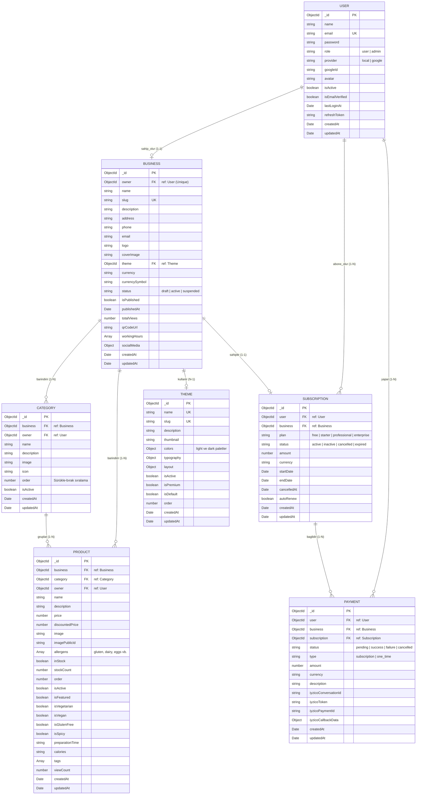

# RestoranQR - Veritabanı Mongoose Şema Dokümantasyonu 🗄️

Bu dokümanda projenin MongoDB Atlas üzerinde barındırılan tüm veri modelleri, şema yapıları, veri tipleri, ilişkileri ve indeksleri detaylandırılmıştır.

---

## 🏛️ Mimari Varlık İlişki Diyagramı (ERD)

---

## 📋 1. User Şeması (`users`)
Sistemdeki restoran sahiplerini ve platform yöneticilerini tutar.

| Alan Adı | Tip | Zorunlu? | Varsayılan | Açıklama |
| :--- | :--- | :---: | :---: | :--- |
| `_id` | `ObjectId` | Evet | Otomatik | Benzersiz kullanıcı ID'si |
| `name` | `String` | Evet | - | Kullanıcı Adı ve Soyadı |
| `email` | `String` | Evet | - | Benzersiz, küçük harfe dönüştürülmüş e-posta |
| `password` | `String` | Hayır (Google için) | - | Bcrypt (12 salt round) ile hash'lenmiş şifre |
| `role` | `String` | Evet | `'user'` | `'user'` veya `'admin'` |
| `provider` | `String` | Evet | `'local'` | `'local'` veya `'google'` |
| `googleId` | `String` | Hayır | - | Google OAuth ID'si |
| `avatar` | `String` | Hayır | - | Profil fotoğrafı URL'i |
| `isActive` | `Boolean` | Evet | `true` | Hesap aktif mi? |
| `isEmailVerified`| `Boolean` | Evet | `false` | E-posta doğrulandı mı? |
| `lastLoginAt` | `Date` | Hayır | - | Son başarılı giriş tarihi |
| `refreshToken` | `String` | Hayır | - | Hash'lenmiş JWT yenileme token'ı |
| `timestamps` | `Date` | Evet | Otomatik | `createdAt` ve `updatedAt` |

**İndeksler:**
- `{ email: 1 }` (Unique)
- `{ googleId: 1 }`

---

## 🏢 2. Business Şeması (`businesses`)
Multi-tenant mimarisindeki restoran ve kafe işletmelerinin profilleridir.

| Alan Adı | Tip | Zorunlu? | Varsayılan | Açıklama |
| :--- | :--- | :---: | :---: | :--- |
| `_id` | `ObjectId` | Evet | Otomatik | Benzersiz işletme ID'si |
| `owner` | `ObjectId` | Evet | - | `User` modeline referans (1 kullanıcı = 1 işletme) |
| `name` | `String` | Evet | - | İşletme Adı (Örn: Bella Italia) |
| `slug` | `String` | Evet | - | URL adı (Örn: `bella-italia-52yaag`, benzersiz) |
| `description` | `String` | Hayır | - | İşletme sloganı veya kısa açıklaması |
| `address` | `String` | Hayır | - | Açık restoran adresi |
| `phone` | `String` | Hayır | - | Restoran iletişim numarası |
| `email` | `String` | Hayır | - | Restoran iletişim e-postası |
| `logo` | `String` | Hayır | - | Cloudinary logo URL'i |
| `coverImage` | `String` | Hayır | - | Cloudinary kapak görseli URL'i |
| `theme` | `ObjectId` | Hayır | - | `Theme` modeline referans |
| `currency` | `String` | Hayır | `'TRY'` | Para birimi kodu |
| `currencySymbol`| `String` | Hayır | `'₺'` | Menüde gösterilecek sembol (`₺`, `$`, `€`) |
| `status` | `String` | Evet | `'draft'` | `'draft'`, `'active'`, `'suspended'` |
| `isPublished` | `Boolean` | Evet | `false` | Menü müşterilere açık mı? |
| `publishedAt` | `Date` | Hayır | - | Menünün yayına alınma zamanı |
| `totalViews` | `Number` | Evet | `0` | Menü QR okutulma ve görüntülenme sayısı |
| `qrCodeUrl` | `String` | Hayır | - | Üretilen QR kod görselinin Cloudinary linki |
| `workingHours` | `Array` | Evet | 7 Gün Tanımlı | `{ day, open, close, isOpen }` dizisi |
| `socialMedia` | `Object` | Hayır | - | `{ instagram, facebook, twitter, website }` |

**İndeksler:**
- `{ owner: 1 }` (Unique)
- `{ slug: 1 }` (Unique)
- `{ isPublished: 1 }`
- `{ status: 1 }`

---

## 🗂️ 3. Category Şeması (`categories`)
Menüdeki bölümleri (Başlangıçlar, Pizzalar, İçecekler vb.) barındırır.

| Alan Adı | Tip | Zorunlu? | Varsayılan | Açıklama |
| :--- | :--- | :---: | :---: | :--- |
| `_id` | `ObjectId` | Evet | Otomatik | Kategori ID'si |
| `business` | `ObjectId` | Evet | - | Ait olduğu `Business` referansı |
| `owner` | `ObjectId` | Evet | - | Ait olduğu kullanıcı (`User`) referansı |
| `name` | `String` | Evet | - | Kategori başlığı |
| `description` | `String` | Hayır | - | Kategori alt açıklaması |
| `image` | `String` | Hayır | - | Görsel URL'i |
| `order` | `Number` | Evet | `0` | Sürükle & bırak sıralama önceliği |
| `isActive` | `Boolean` | Evet | `true` | Menüde gösterilsin mi? |

**İndeksler:**
- `{ business: 1, order: 1 }`
- `{ business: 1, isActive: 1 }`

---

## 🍕 4. Product Şeması (`products`)
Kategorilerin altındaki yemek, tatlı ve içecekleri temsil eder.

| Alan Adı | Tip | Zorunlu? | Varsayılan | Açıklama |
| :--- | :--- | :---: | :---: | :--- |
| `_id` | `ObjectId` | Evet | Otomatik | Ürün ID'si |
| `business` | `ObjectId` | Evet | - | `Business` referansı |
| `category` | `ObjectId` | Evet | - | `Category` referansı |
| `owner` | `ObjectId` | Evet | - | `User` referansı |
| `name` | `String` | Evet | - | Ürün adı (Örn: Pizza Margherita) |
| `description` | `String` | Hayır | - | İçindekiler ve açıklama |
| `price` | `Number` | Evet | - | Ürün fiyatı |
| `discountedPrice` | `Number` | Hayır | - | Kampanyalı / indirimli fiyat |
| `image` | `String` | Hayır | - | Cloudinary ürün fotoğrafı URL'i |
| `allergens` | `[String]`| Hayır | `[]` | Alerjenler (`gluten`, `dairy`, `eggs`, vb.) |
| `inStock` | `Boolean` | Evet | `true` | Stokta var mı? (Tükendi toggle'ı) |
| `order` | `Number` | Evet | `0` | Kategori içindeki gösterim sırası |
| `isVegetarian` | `Boolean` | Evet | `false` | Vejetaryen rozeti |
| `isVegan` | `Boolean` | Evet | `false` | Vegan rozeti |
| `isGlutenFree` | `Boolean` | Evet | `false` | Glutensiz rozeti |
| `isSpicy` | `Boolean` | Evet | `false` | Acılı lezzet ikonu |
| `calories` | `String` | Hayır | - | Kalori bilgisi (Örn: "750 kcal") |
| `preparationTime` | `String` | Hayır | - | Hazırlık süresi (Örn: "15 dk") |

**İndeksler:**
- `{ business: 1, category: 1, order: 1 }`
- `{ business: 1, isActive: 1 }`

---

## 🎨 5. Theme Şeması (`themes`)
Müşteri menüsünün (`/m/[slug]`) dinamik renk ve tipografi görünümünü belirler.

| Alan Adı | Tip | Açıklama |
| :--- | :--- | :--- |
| `name` | `String` | Tema adı (`Minimal`, `Klasik`, `Dark Elegance`, `Renkli & Enerjik`, `Elegant Gold`) |
| `slug` | `String` | Benzersiz tema kodu (`minimal`, `klasik`, `dark`, vb.) |
| `colors.light` | `Object` | Açık mod renkleri (`primary`, `secondary`, `background`, `surface`, `text`, `border`) |
| `colors.dark` | `Object` | Koyu mod renkleri (`primary`, `secondary`, `background`, `surface`, `text`, `border`) |
| `typography` | `Object` | Font ailesi (`Inter`, `Playfair Display`, `Poppins`, `Cormorant Garamond`) |
| `layout` | `Object` | Kenar yuvarlaklığı (`borderRadius`), gölge (`cardShadow`), azami genişlik |
| `isDefault` | `Boolean` | Yeni kayıt olan işletmelere varsayılan atanacak tema mı? |

---

## 💳 6. Subscription & Payment Şemaları
SaaS abonelik modeli ve iyzico ödeme akışını yönetir.

### `subscriptions`
- `user`: Kullanıcı ID'si
- `business`: İşletme ID'si
- `plan`: `'free'`, `'starter'`, `'professional'`, `'enterprise'`
- `status`: `'active'`, `'inactive'`, `'cancelled'`, `'expired'`
- `amount`: Paket tutarı (Örn: 399 ₺)
- `startDate` & `endDate`: Abonelik dönemi

### `payments`
- `iyzicoConversationId`: iyzico işlem takip kodu (UUID)
- `iyzicoToken`: Ödeme formu token'ı
- `iyzicoPaymentId`: Başarılı ödeme referans numarası
- `status`: `'pending'`, `'success'`, `'failure'`
- `amount`: Çekilen tutar
- `iyzicoCallbackData`: iyzico'dan dönen tam webhook verisi
