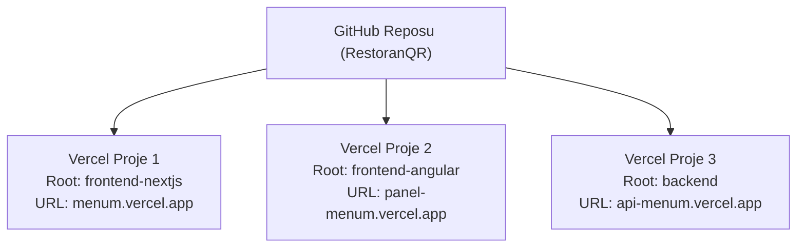

# RestoranQR - Tek Terminalde Çalıştırma ve Vercel Deploy Rehberi 🚀

Bu kılavuz, projeyi yerel ortamda **tek bir terminal penceresinden** aynı anda çalıştırmayı ve projeyi **Vercel** bulut platformuna profesyonel bir SaaS monorepo mimarisiyle deploy etmeyi adım adım açıklar.

---

## ⚡️ 1. Bölüm: Yerel Ortamda TEK TERMİNALDE Çalıştırma

Projenin kök dizinine eklenen monorepo orkestrasyonu (`concurrently`) sayesinde artık 3 ayrı terminal açmanıza gerek yoktur.

### Tek Komutla Başlatma:
Projenin ana dizininde (`RestoranQR/`):

```bash
npm run dev
```

Bu komut tek bir terminal penceresinde **aynı anda**:
- 🔵 `[backend]` -> NestJS Backend (`http://localhost:3001`)
- 🟢 `[nextjs]`  -> Next.js Landing & Müşteri Menüsü (`http://localhost:3000`)
- 🟣 `[angular]` -> Angular Yönetim Paneli (`http://localhost:4200`)

servislerini renk kodlu etiketlerle başlatır. Herhangi bir servisin log çıktısı veya hatası bu tek terminale anlık olarak akar. Durdurmak istediğinizde `Ctrl + C` tuşlamanız tüm servisleri tek seferde güvenle kapatır.

### Diğer Kök Dizin Komutları:
```bash
# Tüm servislerin bağımlılıklarını tek seferde kurar
npm run install:all

# 3 servisi de tek seferde production için derler
npm run build

# Tekil servis çalıştırma kısayolları
npm run start:backend
npm run start:nextjs
npm run start:angular
```

---

## ☁️ 2. Bölüm: Vercel'e Deploy Etme Mimarisi

Vercel, Git reposu tabanlı çalışan bir Serverless & Edge platformudur. Monorepo (içinde birden fazla uygulama barındıran repo) projeleri Vercel'e deploy etmenin **en temiz, modern ve endüstri standardı yöntemi** Vercel'in yerleşik **"Root Directory" (Kök Dizin)** özelliğini kullanmaktır.

Vercel ücretsiz planda bile aynı GitHub reposundan **sınırsız sayıda bağımsız proje** oluşturmanıza izin verir.



---

## 🚀 3. Bölüm: Adım Adım Vercel Kurulumu

### Adım 1: Projeyi GitHub'a Gönderin (Push)
Projenizin güncel halini GitHub reponuza push edin:
```bash
git add .
git commit -m "feat: monorepo root package.json and vercel configurations"
git push origin main
```

---

### Adım 2: Müşteri Menüsü & Landing Deploy (Next.js)
1. [Vercel Dashboard](https://vercel.com/dashboard)'a gidin ve **"Add New..." -> "Project"** butonuna tıklayın.
2. GitHub'daki `RestoranQR` reponuzu seçip **Import** deyin.
3. **Configure Project** ekranında:
   - **Project Name**: `restoran-qr` (veya dilediğiniz isim)
   - **Framework Preset**: `Next.js` (otomatik algılanır)
   - **Root Directory**: `Edit` butonuna basın ve `frontend-nextjs` klasörünü seçin.
4. **Environment Variables** bölümüne:
   - `NEXT_PUBLIC_API_URL`: Backend API adresinizi girin (örn: `https://api-restoran-qr.vercel.app/api`)
5. **Deploy** butonuna basın! 1-2 dakika içinde canlıya alınır.

---

### Adım 3: Restoran Yönetim Paneli Deploy (Angular 18)
1. Vercel Dashboard'da tekrar **"Add New..." -> "Project"** butonuna tıklayın.
2. Aynı `RestoranQR` reposunu seçin.
3. **Configure Project** ekranında:
   - **Project Name**: `panel-restoran-qr`
   - **Framework Preset**: `Angular` seçin.
   - **Root Directory**: `Edit` butonuna basıp `frontend-angular` seçin.
4. Projenin içine eklediğimiz `frontend-angular/vercel.json` dosyası sayesinde Angular SPA router yönlendirmeleri (`/dashboard`, `/auth/login` vb.) 404 vermeden sorunsuz çalışır.
5. **Deploy** butonuna basın!

---

### Adım 4: Backend API Deploy (NestJS)

NestJS backend'i Vercel'e deploy etmek için iki harika seçeneğiniz vardır:

#### Seçenek A: Vercel Serverless Olarak Deploy Etme (Tamamen Vercel İçi)
1. Vercel Dashboard'da **"Add New..." -> "Project"** deyin ve aynı repoyu seçin.
2. **Project Name**: `api-restoran-qr`
3. **Root Directory**: `backend` seçin.
4. Proje içerisindeki `backend/vercel.json` Vercel Node motorunu otomatik devreye sokacaktır.
5. **Environment Variables** bölümüne `backend/.env` içindeki değerleri ekleyin:
   - `MONGODB_URI`: MongoDB Atlas bağlantı cümleniz
   - `JWT_SECRET`: Güvenlik anahtarınız
   - `CLOUDINARY_CLOUD_NAME`: `whfouru9`
   - `CLOUDINARY_API_KEY`: `339639355141929`
   - `CLOUDINARY_API_SECRET`: `WYP78hlBmSxl9SI8YZw0BHnnbtU`
   - `FRONTEND_URL`: Angular panel Vercel URL'iniz (`https://panel-restoran-qr.vercel.app`)
   - `NEXTJS_URL`: Next.js Vercel URL'iniz (`https://restoran-qr.vercel.app`)
6. **Deploy** butonuna basın.

#### Seçenek B (Önerilen Alternatif): Render veya Railway Üzerinde Barındırma
NestJS gibi kurumsal Node.js backend'leri için Vercel'in serverless cold-start (soğuk başlama) sınırlarından etkilenmemek adına backend'i [Render.com](https://render.com) veya [Railway.app](https://railway.app) üzerinde **ücretsiz persistent web service** olarak çalıştırmak da yaygın bir tercihtir. Bu servislerde de tek yapmanız gereken reponuzu bağlayıp root directory olarak `backend` seçmektir.

---

## 🌐 4. Bölüm: Canlı Ortam Alan Adı (Custom Domain) Eşleştirmesi

Kendi domaininizi bağlarken Vercel DNS ile şu yapıyı kurabilirsiniz:

| Alt Alan Adı (Subdomain) | Vercel Projesi | Görevi |
|---|---|---|
| `restoraniniz.com` | `frontend-nextjs` | Ziyaretçi Landing & Müşteri QR Menüleri (`/m/slug`) |
| `panel.restoraniniz.com` | `frontend-angular` | Restoran Sahipleri & Süper Admin Girişi |
| `api.restoraniniz.com` | `backend` | REST API ve Swagger Dokümantasyonu |

Bu sayede tam teşekküllü, profesyonel bir SaaS altyapısına sahip olursunuz.
